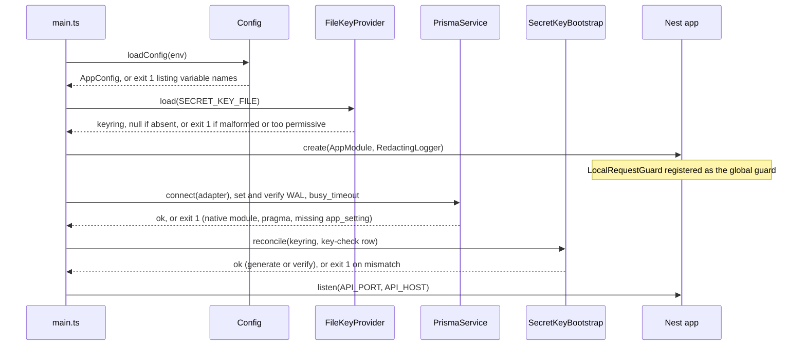
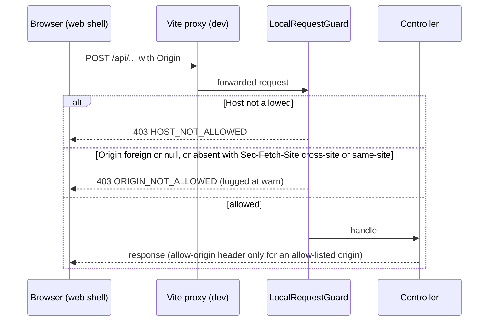

# Design: Foundation for the Shopify Catalog Importer (S0)

S0 is an ESM pnpm workspace with three packages. The API keeps framework-free kernel code (`Money`, `SecretBox`, redaction) behind ports, validates configuration and the secret key before it listens, and rejects browser requests that do not come from the local web shell. Nothing calls Shopify.

Reading order: decisions D1 to D10, then the tree, flows, file table and delivery units.

Marks: **[VS]** = relies on library behaviour not covered by research; verify at scaffold time (list at the end). **[UV]** = dependency whose version is unresolved and must be resolved at scaffold time.

## Technical Approach

This design covers the seven capability specs under `specs/` and decides the eight points they defer (D3, D4, D5, D7, D8 and the health contract). Option A from the exploration, unchanged: `apps/api` (NestJS 12), `apps/web` (React 19, Vite 8, Tailwind 4), `packages/contracts` (zod). Research defaults are adopted without departure: Node 24 floor, pnpm 12, Prisma 7.10.x with the `prisma-client` generator, explicit `output`, `prisma.config.ts` and `@prisma/adapter-better-sqlite3`, Vitest 5. All versions are re-resolved and pinned exactly when scaffolding.

Layer rules, enforced by lint (D2):

| Area | May import | Must not import |
|---|---|---|
| `packages/contracts` | zod | anything in `apps/` |
| `apps/web` | contracts, React | `apps/api`, Node built-ins |
| `apps/api/src/shared-kernel` | Node built-ins | NestJS (except `*.module.ts`), Prisma, other modules |
| API ports (`*.port.ts`, kernel interfaces) | kernel | `infrastructure/`, `persistence/` |

## Architecture Decisions

### D1. Workspace layout and module system

| Topic | Decision | Rejected | Rationale |
|---|---|---|---|
| Packages | `@importer/api`, `@importer/web`, `@importer/contracts`; private root `shopify-catalog-importer` | Unscoped names | Scope makes workspace imports unmistakable |
| Module system | ESM everywhere: `"type": "module"`, `module`/`moduleResolution` `NodeNext` (api, contracts), `Bundler` (web) | CommonJS API | Vite and Vitest are ESM-first; Prisma 7's generated client is ESM by default (S17). NestJS 12 under ESM is **[VS]**; fallback is a CommonJS API on Node 24 that loads the ESM contracts build through `require` **[VS]** |
| tsconfig | One `tsconfig.base.json` (strict, `noUncheckedIndexedAccess`, `exactOptionalPropertyTypes`, `verbatimModuleSyntax`); each package extends it. No project references | `composite` references | Three packages and one dependency edge; references conflict with Vite's `noEmit` flow. pnpm's topological order builds contracts first |
| Contracts consumption | Built output: `tsc` emits `dist` (JS and `.d.ts`); `exports` point to `dist`. `predev`, `pretypecheck` and `pretest` at the root build it; `dev` watches it | Source exports (`./src/index.ts`); custom export conditions | The API runs compiled JS in Node, so one resolution path serves runtime, types and both apps |
| Dependency injection | Explicit `@Inject(TOKEN)` on every constructor parameter; kernel classes are wired with `useFactory` | Relying on `emitDecoratorMetadata` | Ports are interfaces and need tokens anyway; tests do not depend on the test transform emitting metadata **[VS]** |
| HTTP platform | NestJS default Express platform | Fastify platform | Fewer moving parts; revisit only with evidence |
| Generated client | `apps/api/src/generated/prisma`, gitignored, produced by `db:generate` | Committing it | Keeps diffs reviewable. Strict flags against generated source are **[VS]** |

### D2. Lint and format

| Decision | Rejected | Rationale |
|---|---|---|
| ESLint (flat config) with `typescript-eslint` type-aware rules, plus Prettier and `eslint-config-prettier`. All **[UV]** | Biome (one tool, faster) | The layer rules above need `no-restricted-imports`; `no-floating-promises` matters for the S5 engine. `process.env` is banned outside `config/` and `vite.config.ts` |

### D3. First migration

| Decision | Rejected | Rationale |
|---|---|---|
| One table, `app_setting` (`key TEXT PRIMARY KEY`, `value TEXT NOT NULL`, `updated_at`), model `AppSetting` | Empty migration (proves nothing is readable or writable); a store-connection table (pre-empts S2) | Generic key-value storage that S0 itself uses: it holds the `SecretBox` key-check record (D4). It proves migrate, connect, write and read through the adapter |

Connection setup: `PrismaService` sets `journal_mode=WAL`, `busy_timeout` and `foreign_keys=ON`, reads them back and fails boot when `journal_mode` is not `wal`. Whether this is done by adapter options or raw pragmas is **[VS]**. Migrations are applied explicitly with `pnpm db:migrate`, which is idempotent **[VS]**. Boot creates `DATA_DIR` and the database file when absent, aborts naming `DATA_DIR` when the path is not writable, and aborts with the `db:migrate` instruction when `app_setting` is missing. Boot never applies migrations itself, so it spawns no subprocess. `PrismaService.isReachable()` runs a trivial query and returns a boolean instead of throwing; `/health` uses it.

### D4. SecretBox

| Topic | Decision |
|---|---|
| Algorithm | AES-256-GCM, Node `crypto`, 12-byte random IV per call, 16-byte tag |
| Envelope (TEXT) | `sb1.<keyId>.<iv>.<ciphertext>.<tag>`, base64url segments; `sb1` is the format version, `keyId` the key version (`k1`) |
| Binding | Additional authenticated data `sb1|<keyId>|<context>`; the caller passes `context` (for example a record and field name), so an envelope cannot be moved to another row or field |
| Key source | Key file only, path `SECRET_KEY_FILE`, default `~/.shopify-catalog-importer/secret.key`. Lines of `<keyId>:<base64 of 32 bytes>` |
| Rejected | Key in an environment variable: it would sit in `.env` beside the code, be inherited by child processes, and could not be generated on first run. It can be added later as a second `KeyProvider` adapter |
| Why outside the repository tree | Cannot be committed, survives `git clean`, and is not copied along with `data/` |
| Logging | Key material is never logged; errors name the path and the reason only |
| Rotation (later, not built) | Append `k2`; new writes use the highest id; a re-encryption pass rewrites `k1` envelopes; then remove `k1`. The envelope and file formats already carry the id |

Boot behaviour:

| Key file | Key-check row | Result |
|---|---|---|
| Absent | Absent | Generate `k1` (exclusive create, mode `0600`, directory `0700`), write the row, warn once to back up the file |
| Present | Absent | Write the row |
| Present | Present | Decrypt the row; on failure exit 1 ("key does not match this database") |
| Absent | Present | Exit 1; never regenerate |
| Malformed, wrong length, duplicate id, or group/other permission bits set | Any | Exit 1; file left untouched. The permission check is skipped with a warning on Windows |

`AesGcmSecretBox` itself never generates a key: constructing it without a keyring fails with `KEY_MISSING`, naming `SECRET_KEY_FILE`. Generation belongs to the bootstrap step and happens only in the first row above. The key-check row is the encryption of a fixed public constant; it is neither a credential nor key material, so the database still stores no credential in S0. `.gitignore` also lists `*.key` for operators who point `SECRET_KEY_FILE` inside the workspace.

At decrypt time, a tampered envelope and a wrong key are indistinguishable; both raise `SecretBoxError` (`DECRYPT_FAILED`) with no plaintext or ciphertext in the message. A malformed envelope raises `MALFORMED_ENVELOPE`.

### D5. Money

| Topic | Decision |
|---|---|
| Representation | Immutable; internally an unscaled `bigint` plus `scale`. Persisted and transported as the canonical string (TEXT, JSON string). No currency field: currency belongs to the store |
| Accepted grammar | `^-?[0-9]+(\.[0-9]+)?$` on ASCII, string input only, no length bound (the spec requires `12345678901234567890.123456789` to round-trip) |
| Canonical form | Matches `^-?(0|[1-9][0-9]*)(\.[0-9]*[1-9])?$`: leading zeros removed (`007.50` becomes `7.5`), trailing fraction zeros and a then-empty fraction removed (`12.00` becomes `12`), no `+`, and zero is always `0` (`-0`, `-0.00`, `000` all become `0`). Equal values therefore give identical output |
| Sign | A leading `-` is accepted; `+` is rejected. Whether a price may be negative is a validation rule for S1, exposed through `isNegative()` |
| Rejected | Any comma (`1,234`, `1.234,56`, `12,50`), `+`, exponent, `.5`, `5.`, more than one `.`, any whitespace, currency symbols, empty string, `NaN` and infinity literals, non-ASCII digits, non-string input (including JS numbers) |
| Operations | `add`, `equals`, `compare`, `toFixed(n)` (pads; throws when the significant scale exceeds `n`), `toJSON()` returning the canonical string. All return new instances |
| Library | None. Parsing, canonical form, comparison and addition on `bigint` are about 130 lines with no dependency to audit |
| Rejected | `big.js` or `decimal.js` **[UV]** (not researched): adopt one only when a slice needs multiplication, division or rounding |

### D6. Configuration

One zod schema in `apps/api/src/config`, evaluated before `NestFactory.create`. Root `.env` is loaded with Node's built-in env-file loader **[VS]**; `@nestjs/config` and `dotenv` are rejected as unneeded. Failure prints every invalid variable name and reason, never a value, and exits 1. Relative paths resolve against the workspace root through one helper shared by the server and `prisma.config.ts`.

| Variable | Default | Rule |
|---|---|---|
| `NODE_ENV` | `development` | `development`, `test`, `production` |
| `API_HOST` | `127.0.0.1` | Non-loopback requires `ALLOW_NON_LOOPBACK=true` |
| `API_PORT` | `3000` | 1 to 65535 |
| `WEB_HOST` | `127.0.0.1` | Same loopback rule; read by Vite |
| `WEB_PORT` | `5173` | 1 to 65535 |
| `ALLOW_NON_LOOPBACK` | `false` | Explicit opt-in, see D7 |
| `ALLOWED_ORIGINS` | derived: `http://127.0.0.1:<WEB_PORT>`, `http://localhost:<WEB_PORT>` | Comma list of bare origins (no path, no `*`); CORS allow-list and guard allow-list |
| `SHOPIFY_API_VERSION` | `2026-10` | `^\d{4}-(01|04|07|10)$`; stored, never used in S0 |
| `DATA_DIR` | `./data` | Database is `<DATA_DIR>/importer.db` |
| `SECRET_KEY_FILE` | `~/.shopify-catalog-importer/secret.key` | See D4 |
| `SQLITE_BUSY_TIMEOUT_MS` | `5000` | Positive integer |
| `LOG_LEVEL` | `info` | `error`, `warn`, `info`, `debug` |

No variable is prefixed `VITE_`, so no environment value reaches the browser bundle.

### D7. Local security baseline

| Topic | Decision | Rejected |
|---|---|---|
| Bind | `listen(API_PORT, API_HOST)`, defaults `127.0.0.1:3000`; Vite `server.host = WEB_HOST`, default `127.0.0.1:5173`, strict port | Binding all interfaces by default |
| Non-loopback opt-in | `ALLOW_NON_LOOPBACK=true` (the literal `true`; any other value is a configuration error, not `false`). Loopback means `127.0.0.0/8`, `::1` or `localhost`. Without the opt-in, a non-loopback `API_HOST` or `WEB_HOST` aborts configuration with an error naming that variable. With it, boot logs one `warn` event `non_loopback_bind` carrying host and port and stating that the API has no authentication | A CLI flag (not visible in `env.example`); silently honouring the host |
| CORS | Enabled with an exact-match allow-list: the `ALLOWED_ORIGINS` set, default `http://127.0.0.1:5173` and `http://localhost:5173`. Methods `GET, POST, PUT, PATCH, DELETE`; request header `Content-Type`; no credentials; no wildcard; `Vary: Origin`. Other origins receive no allow header **[VS]** | Wildcard; reflecting the request origin; no CORS at all (the first draft of this design, dropped because the spec requires an allow-list) |
| Dev transport | Vite proxy forwards `/api` and `/health` to the API, so the web shell is same-origin in development **[VS]**. The CORS allow-list covers a direct cross-origin call | Relying on CORS alone |
| Routes | Feature routes under the `/api` prefix; `/health` at the root **[VS]** | Stripping a prefix in the proxy |
| Guard | One global `LocalRequestGuard`, no bypass decorator | Per-controller opt-in |

`LocalRequestGuard` rules, in order:

1. Every request: the `Host` header must match the API's own host and port or the host of an allowed origin; otherwise 403 `HOST_NOT_ALLOWED`. This goes beyond the spec: it closes DNS rebinding, which also affects reads and which no origin check covers. With the non-loopback opt-in, the operator adds the externally used origin to `ALLOWED_ORIGINS`.
2. Non-safe methods (anything other than `GET`, `HEAD`, `OPTIONS`) with an `Origin` header: it must equal an allowed origin or the API's own origin; a foreign origin or `null` gives 403 `ORIGIN_NOT_ALLOWED` and the handler does not run.
3. Non-safe methods with no `Origin` header: allowed only when `Sec-Fetch-Site` is absent, `same-origin` or `none`; `cross-site` or `same-site` gives 403 `ORIGIN_NOT_ALLOWED`.

Rule 3 confirms the spec's proposed default (allow) with one condition. Reasoning:

- A script-free local client (`curl`, a test, a later CLI) sends neither header. It already runs on the operator's machine, inside the trust boundary of a loopback-only tool, so rejecting it protects nothing.
- A browser attaches `Origin` to cross-origin requests with a non-safe method, and page script cannot remove it. When a privacy setting blanks it, the value is `null`, which rule 2 rejects.
- If a browser request did arrive without `Origin`, the browser-set `Sec-Fetch-Site` header still identifies it, and page script cannot set that header either. `same-site` is rejected because another application on a different `localhost` port is same-site.
- Rule 1 and the loopback bind remain as independent layers. Residual risk: a browser that sends neither header on a cross-site write; accepted and documented as a limitation.

Both header behaviours come from the web platform, not from the research; the guard is tested on header values only **[VS]**.

Rejections return the shared `ApiError` body and are logged at `warn`.

Test-only write route: S0 has no state-changing endpoint, so the HTTP test declares a `POST` controller inside the test file and registers it in a module assembled by that test, next to the real security module. `AppModule` never references it, test files are excluded from `tsconfig.build.json`, and no environment variable can enable it, so it does not exist in a normal run or in `dist`.

### D8. Logger redaction

A dependency-free `RedactingLogger` (NestJS logger interface **[VS]**, one JSON line per event) applies a pure `redact()` function. `pino` is rejected for now: not researched, and path-based redaction does not cover value patterns.

Placement: the spec states the requirement under `local-security-baseline`, but the code lives in `shared-kernel/logging`, because every module logs. `redact()` is a pure function and the logger receives its output sink as a constructor argument, so both are tested without NestJS, HTTP or the security module.

| Rule | Detail |
|---|---|
| Key name, any depth, case-insensitive | Contains `authorization`, `cookie`, `token`, `secret`, `password`, `signature` or `credential`, or is `key` or ends in `Key`/`_key` with a secret-bearing stem (`apiKey`, `api_key`, `secretKey`, `privateKey`, `encryptionKey`): value becomes `[REDACTED]`. A bare substring match on `key` is rejected because it would redact `product_key` and `keyId`. The list is one exported constant; S3 adds staged-upload `parameters` |
| Value: bearer | `Bearer <anything>` becomes `Bearer [REDACTED]` |
| Value: Shopify token | `shp??_` prefixed tokens (the exploration cites `shpat_`; S2 confirms the family) |
| Value: URL | Every query-string value and any userinfo is redacted; scheme, host and path stay. This covers signed URLs without knowing parameter names |
| Registered secrets | `registerSecret(value)` (minimum 8 characters) redacts exact occurrences inside any string; decrypted values and the key are registered |
| Scope | Applied to messages, context objects and `Error` name, message and stack; depth cap and cycle guard. Request logs carry method, path without query, status and duration only |

### D9. Test strategy

Vitest in every package, tests co-located as `*.test.ts`; tests that touch a file, a port or the database are `*.int.test.ts`. HTTP tests use `fetch` against an ephemeral loopback port, so no HTTP test library is added.

| Script (root) | Runs |
|---|---|
| `dev` | contracts watch, API watch, Vite, in parallel |
| `build` | `pnpm -r build` |
| `typecheck` | `pnpm -r typecheck` |
| `lint` | `eslint .` |
| `format`, `format:check` | `prettier --write .`, `prettier --check .` |
| `test` | `pnpm -r test` (each package: `vitest run`) |
| `check` | `typecheck`, `lint`, `format:check`, `test` |
| `db:generate`, `db:migrate` | `prisma generate`, `prisma migrate deploy` in `@importer/api` |

`openspec/config.yaml` can record `test_command: pnpm test` and `build_command: pnpm build` once unit U1 is merged; it contains real contract tests. `strict_tdd` can be enabled from U2 onward, which is where the first kernel code is written. `coverage_command` stays empty: the coverage provider is **[UV]**.

### D10. Delivery split (recommendation only)

The proposal's two-PR shape does not fit the budget: its second PR would carry roughly 2,300 hand-written lines. The figures below are design-time estimates, not measurements, with an uncertainty of about 30 percent; roughly half is tests. The tasks forecast replaces them.

| Unit | Content | Hand-written | Generated |
|---|---|---|---|
| U1 (proposal 0a) | Root tooling, contracts package, README stub | ~390 | `pnpm-lock.yaml` (thousands of lines) |
| U2 | `@importer/api` package files, `Money`, `redact` and logger | ~520 | Lockfile delta |
| U3 | `SecretBox`, key file provider | ~410 | none |
| U4 | Config schema, loader, paths | ~250 | none |
| U5 | `main.ts`, CORS, `LocalRequestGuard`, `/health` | ~480 | none |
| U6 | Prisma schema and config, `PrismaService`, `app_setting`, key-check bootstrap | ~390 | Migration SQL (~10 lines), migration lock file, lockfile delta; client not committed |
| U7 | Web shell, bundle check, README completion | ~270 | Lockfile delta |

Recommended: chain U1 to U7 as stacked PRs. U2 and U5 are over the budget on these estimates and may need a further split (`Money` apart from logging; the guard apart from `/health`). Alternative: keep two PRs (U1; U2 to U7) with an explicit `size:exception`. The user decides after the tasks forecast.

## Directory Tree

```
.
├── package.json  pnpm-workspace.yaml  pnpm-lock.yaml
├── tsconfig.base.json  eslint.config.js  .prettierrc.json  .prettierignore
├── .gitignore  .node-version  env.example  README.md
├── packages/contracts/
│   ├── package.json  tsconfig.json  vitest.config.ts
│   └── src/  index.ts  health.ts  api-error.ts  money.ts  (+ tests)
├── apps/api/
│   ├── package.json  tsconfig.json  tsconfig.build.json  vitest.config.ts  prisma.config.ts
│   ├── prisma/  schema.prisma  migrations/<timestamp>_baseline/migration.sql
│   └── src/
│       ├── main.ts  app.module.ts
│       ├── config/          env.schema.ts  load-config.ts  paths.ts  config.module.ts
│       ├── shared-kernel/
│       │   ├── money/       money.ts
│       │   ├── logging/     redact.ts  redacting-logger.ts
│       │   └── secret-box/  secret-box.port.ts  key-provider.port.ts  key-check-store.port.ts
│       │                    secret-key-bootstrap.ts
│       │                    infrastructure/  aes-gcm-secret-box.ts  file-key-provider.ts
│       ├── persistence/     prisma.service.ts  prisma-key-check-store.ts  persistence.module.ts
│       ├── local-security/  allowed-origins.ts  local-request.guard.ts  local-security.module.ts
│       ├── health/          health.controller.ts  health.module.ts
│       └── generated/prisma/   (gitignored)
└── apps/web/
    ├── package.json  tsconfig.json  vite.config.ts  index.html
    └── src/
        ├── main.tsx  styles.css  i18n/es.ts  api/http-client.ts
        ├── app/  App.tsx  HealthStatusContainer.tsx  useHealth.ts
        └── ui/   atoms/StatusDot.tsx  molecules/HealthBadge.tsx
```

No folder is created for S1 to S7 modules. The web shell is one page that shows the API health result; it has no router and no feature screen. `features/<screen>/` and `ui/organisms/` are conventions recorded here and created by the first slice that fills them.

## Data Flow

### Boot path

Implemented as one ordered `bootstrap()` function, not as lifecycle-hook ordering. `listen` is the last step.



### Guarded write request



## File Changes

| File | Action | Description |
|---|---|---|
| `package.json`, `pnpm-workspace.yaml` | Create | Scripts (D9), `engines.node >=24`, exact `packageManager`, build approval for `better-sqlite3` **[VS]** |
| `tsconfig.base.json`, `eslint.config.js`, `.prettierrc.json`, `.prettierignore`, `.node-version` | Create | Tooling (D1, D2) |
| `.gitignore` | Modify | Add `node_modules`, `dist`, `data/`, `.env`, `*.key`, `apps/api/src/generated/` |
| `env.example` | Create | Every variable in D6, no secrets |
| `README.md` | Create | Spanish quick start: prerequisites, install, migrate, run, test, key backup |
| `packages/contracts/**` | Create | `HealthResponse`, `ApiError`, `MoneyString`, tests |
| `apps/api/src/config/**` | Create | Schema, loader, path helper |
| `apps/api/src/shared-kernel/**` | Create | `Money`, redaction, logger, `SecretBox` ports and adapters, key bootstrap |
| `apps/api/src/persistence/**`, `apps/api/prisma/**`, `apps/api/prisma.config.ts` | Create | Adapter wiring, baseline migration, key-check store |
| `apps/api/src/local-security/**`, `apps/api/src/health/**`, `main.ts`, `app.module.ts` | Create | Guard, `/health`, ordered bootstrap |
| `apps/web/**` | Create | Vite, Tailwind, one-page shell showing the API health result |

## Interfaces / Contracts

Shared (`packages/contracts`), zod **[UV]**:

```ts
HealthResponse = { status: 'ok' | 'degraded'; database: 'up' | 'down'; shopifyApiVersion: string }
ApiError = { error: { code: 'HOST_NOT_ALLOWED' | 'ORIGIN_NOT_ALLOWED'; message: string } }
MoneyString = string matching the canonical form in D5
```

`GET /health`:

| Database | Status | Body |
|---|---|---|
| Reachable | 200 | `{ status: 'ok', database: 'up', shopifyApiVersion }` |
| Unreachable | 503 | `{ status: 'degraded', database: 'down', shopifyApiVersion }` |

503 is chosen over an always-200 response so that `curl --fail`, scripts and the README boot check can rely on the status code alone; the body has the same schema in both cases. The body carries no path, key, host or other configuration value. `/health` is a safe method, so rules 2 and 3 of the guard never apply to it. Error `message` is English; the web shell maps `code` to Spanish copy in `i18n/es.ts`.

Backend only (`apps/api`):

```ts
interface SecretBox { encrypt(plaintext: string, context: string): string; decrypt(envelope: string, context: string): string }
interface KeyProvider { load(): Keyring | null; generate(): Keyring }
interface KeyCheckStore { read(keyId: string): Promise<string | null>; write(keyId: string, envelope: string): Promise<void> }
class Money { static parse(input: string): Money; static tryParse(input: unknown): MoneyResult
              readonly scale: number; isNegative(): boolean; add(other: Money): Money
              toString(): string; toJSON(): string; toFixed(scale: number): string
              equals(other: Money): boolean; compare(other: Money): -1 | 0 | 1 }
```

Frontend (`apps/web`): `useHealth()` fetches `/health`, parses it with `HealthResponse` from contracts and returns `{ state: 'loading' | 'ok' | 'degraded' | 'unreachable' }`; `HealthStatusContainer` passes it to the presentational `HealthBadge`. The web package depends on `@importer/contracts` only.

## Testing Strategy

| Layer | What | Approach |
|---|---|---|
| Unit | `Money` | Table of accepted and rejected inputs; canonical form including negative zero; `add` (`0.1` plus `0.2` is `0.3`); long-value and JSON round trips; immutability; `toFixed`; compare |
| Unit | `AesGcmSecretBox` | Round trip; tamper with IV, ciphertext, tag, key id, context; wrong key; malformed envelope; IV differs per call |
| Unit | `redact` and logger | Key names at depth; each value pattern; registered secret inside a longer string; `Error`; cycles; a seeded secret is absent from captured output bytes |
| Unit | Config, `LocalRequestGuard`, contracts | Defaults, each failure, non-loopback opt-in, `env.example` lists every schema variable; method, `Host`, `Origin` and `Sec-Fetch-Site` matrix; schema parse |
| Integration | Key file | Temp directory: generated with `0600`, loose permissions rejected, malformed rejected, never overwritten |
| Integration | Persistence | Apply the committed `migration.sql` to an empty temp file, open through the adapter, write and read `app_setting`, assert WAL and `busy_timeout`; the four key-check states |
| Integration | HTTP | App on an ephemeral loopback port with the test-only `POST` controller (D7): `/health` 200 and 503; foreign origin 403 with the handler not run; allowed origin and no-origin writes pass; preflight allows only allow-listed origins; foreign-origin `GET /health` runs with no allow header; bound address is loopback |
| Web | `HealthBadge` | Server-side render to string in the Node environment; DOM test libraries are deferred to S6 |
| Build output | Web bundle | After `pnpm build`, a test scans `apps/web/dist` for `@importer/api` and a seeded secret and expects neither |
| E2E | None | Playwright is out of scope for S0 |

## Threat Matrix

N/A: no agent routing, shell, subprocess, VCS/PR automation, executable-file classification, or process-integration boundary. Boot deliberately spawns no subprocess (D3). HTTP request threats are handled in D7.

## Migration / Rollout

No data migration; the repository is empty. Rollback is the proposal's: revert in reverse order, delete `data/` and the key file.

Native module risk: `better-sqlite3` needs a prebuilt binary for the operator's platform and Node ABI, or a C++ toolchain, and pnpm must be allowed to run its install script **[VS]**. Boot fails fast with the README's prerequisite and rebuild instructions. There is no drop-in fallback inside this design: a different SQLite adapter was not researched and would replace a user-confirmed choice, so it needs its own decision. The same applies when moving to Node 26.

## To Verify at Scaffold Time

1. NestJS 12 runs as native ESM, including the CLI watch mode; else the CommonJS fallback in D1.
2. Explicit `@Inject` tokens work under the Vitest transform without emitted decorator metadata; else add a metadata-emitting transform.
3. The Prisma 7 generated client compiles under the strict base flags; else relax them for the generated folder only.
4. How the adapter exposes pragmas or a busy timeout, and that it holds one connection.
5. `prisma generate` and `prisma migrate deploy` invocation with `prisma.config.ts`, and that no step generates implicitly.
6. Node's built-in env-file loader on Node 24, and whether `prisma.config.ts` needs it called explicitly.
7. pnpm 12 syntax for approving dependency build scripts and for strict engine checks.
8. NestJS global prefix with an excluded `/health` route; the logger interface; `listen(port, host)`.
9. Vite 8 proxy leaves `Host` and `Origin` as the guard expects; `@tailwindcss/vite` setup; the React plugin for Vite 8.
10. NestJS CORS options produce exactly the D7 policy (exact-match list, no credentials, no header for other origins).
11. Browser behaviour assumed by guard rule 3 (`Origin` on non-safe cross-origin requests, `Sec-Fetch-Site` values).
12. Versions of everything marked **[UV]**: zod, ESLint, `typescript-eslint`, Prettier, `eslint-config-prettier`, the React Vite plugin, TypeScript, the coverage provider.

## Open Questions

None blocks tasks.

- [ ] Delivery shape (D10): stacked units or two PRs with a size exception. Asked after the tasks forecast.
- [ ] Default key location in the home directory (D4) departs from the exploration's "path in a gitignored `.env`"; confirm or move it under the workspace.
- [ ] The health spec's requirement sentence says `GET /health` returns 200 while its database-down scenario defers the status to design; this design returns 503 in that case. Align the sentence when the spec is next touched.
- [ ] The persistence spec says the API creates the database file when absent; this design does that but still requires `pnpm db:migrate` before the API will serve. Confirm that explicit migration is acceptable.
