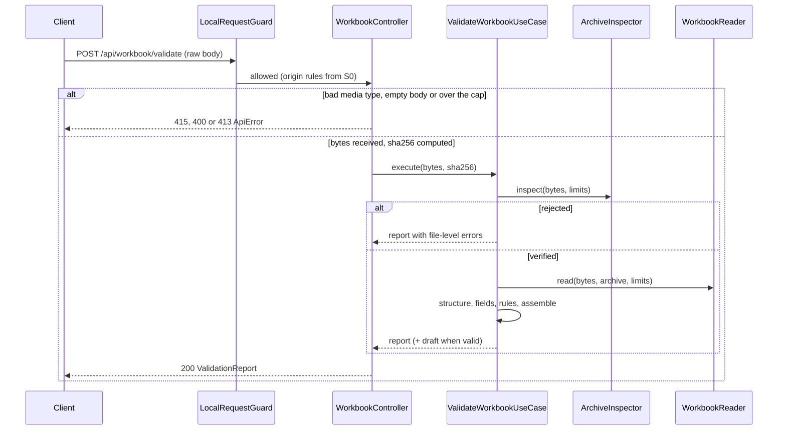

# Design: Workbook and Validation Core (S1)

S1 adds one stateless module, `apps/api/src/catalog-workbook/`. It serves a template and returns a tier A report for an uploaded workbook. An own ZIP preflight checks every upload before any XLSX library sees it. No database, no Shopify, no web screen.

Marks: **[VS]** = depends on library or runtime behaviour that research did not cover; verify in the named unit (list at the end). **[UV]** = version still unresolved.

## Technical Approach

This is approach A from the proposal. The domain is pure TypeScript: cell model, field parsers, rules and the report builder. Ports isolate the three untrusted or replaceable parts: archive inspection, workbook reading and template writing. The S0 conventions still apply: explicit `@Inject` tokens, `useFactory` wiring, `forRoot` dynamic modules, co-located `*.test.ts` and `*.int.test.ts` files, HTTP tests that call `fetch` on an ephemeral loopback port, and English `ApiError` messages. The delta specs written in parallel are authoritative for exact codes, field names and limits. This design fixes structure and mechanisms.

| Area | May import | Must not import (lint) |
|---|---|---|
| `catalog-workbook/domain/**` | contracts, `shared-kernel/money` | `node:*`, `@nestjs/*`, Prisma, `infrastructure/` |
| `catalog-workbook/application/**` | domain, ports, contracts | same as domain |
| `catalog-workbook/ports/*.port.ts` | domain types | existing port rule (`INFRASTRUCTURE`, `NEST`, `PRISMA`) |
| `catalog-workbook/infrastructure/**` | everything above, `node:zlib`, `node:crypto`, NestJS, the chosen library | other modules' internals |

## Architecture Decisions

| # | Topic | Choice | Rejected | Rationale |
|---|---|---|---|---|
| D1 | Module layout | `domain/`, `application/`, `ports/`, `infrastructure/{zip,ooxml,reader,http}/`, `catalog-workbook.module.ts`, `catalog-workbook.tokens.ts` | Flat module like `health/`; putting the parsers in `shared-kernel` | The folder names say what the module does. Rules have no framework dependency, so most tests are fast units. Only `Money` is shared, and it is reused unchanged |
| D2 | Lint | Add `'**/catalog-workbook/**'` to `OTHER_MODULES`. Add one block for `catalog-workbook/{domain,application}/**` with `BUILT_INS`, `NEST`, `PRISMA` and `INFRASTRUCTURE` | No new block | The kernel must not depend on the module. Domain purity is enforced by lint, not by convention |
| D3 | Caps location | A frozen `DEFAULT_WORKBOOK_LIMITS` in `domain/workbook-limits.ts`, provided under the `WORKBOOK_LIMITS` token. `CatalogWorkbookModule.forRoot({ limits? })` lets tests shrink them. No environment variable, no `ConfigModule` | Env variables in the S0 config schema | These caps protect the process. They are not settings an operator needs to tune. Env variables would widen the config schema and the `env.example` test for no user value. A cap can be promoted to an env variable later without touching the domain |
| D4 | XLSX library | Decided by the U3 spike (protocol below). Reading goes only through `WorkbookReader` | Picking a library now | Research left formula, text-cell and limit behaviour unconfirmed (deferred items). Fallback B replaces one adapter file |
| D5 | Template writing | Own minimal OOXML writer in `infrastructure/ooxml/` (parts plus a ZIP writer using `deflateRawSync` and `zlib.crc32`). The test fixture builder builds on it | Writing with the spike library | The template content is fixed and small, and it needs exact output: text format `@` on code columns, a TRUE/FALSE list validation, a frozen header and column widths. Whether a library writer honours the text format is undocumented (C13). Owning the writer removes a dependency and gives deterministic bytes |
| D6 | Upload transport | Raw body: `POST /api/workbook/validate` with `Content-Type` set to the XLSX MIME type or `application/octet-stream`. A bounded stream reader caps the size and computes SHA-256 in the same pass | Multipart with memory storage | No multipart parser to configure or harden. A cross-origin browser request with these content types gets a CORS preflight (multipart form posts do not), so the S0 allow-list applies in addition to the guard. The size cap is exact. Tests send bytes with `fetch` and need no form builder. S6 sends `fetch(url, { body: file })`. Cost: no filename is sent, and S1 does not need one |
| D7 | Error split | Transport problems raise `ApiError` 4xx: missing or empty body 400 `WORKBOOK_FILE_REQUIRED`, wrong media type 415 `WORKBOOK_UNSUPPORTED_MEDIA_TYPE`, more bytes than the upload cap 413 `WORKBOOK_TOO_LARGE`. Every problem with the bytes themselves returns 200 with a report whose blocking issue has `sheet: null`: not a ZIP, encrypted or legacy file, bomb, macros, links, formulas, unreadable | Rejecting bad content with 422 | One rule: a request is a 4xx only when it could not deliver a file. Content always yields a report with the hash, so S6 renders a single shape. Note: the endpoint spec lists only 400 and 413 codes and does not name `WORKBOOK_UNSUPPORTED_MEDIA_TYPE`; the U1 contracts include it (three ApiError codes) |
| D8 | Validation execution | Synchronous and in-process, one pipeline per request (decision 1a). Validation is CPU-bound and blocks the event loop, so validations run one at a time without any extra lock | Worker thread, queue, busy code | Simplest option that fits hundreds to low thousands of products. While a validation runs, `/health` can stall for its duration. This is accepted for a single local operator |
| D9 | Decimals | `domain/fields/decimal-field.ts` adapts cells to `Money` (details below) | A decimal library; JS `number` | `Money` already rejects commas, exponents and `+`. S1 adds the scale, magnitude and sign policy (10a) |
| D10 | Report text | Contracts hold `ISSUE_CODES` (closed zod enum), `ISSUE_PARAM_KEYS` and `ISSUE_MESSAGES_ES` (message and suggested-action templates). The API renders `message` and `suggestedAction` into each issue with `renderIssue()` from contracts. The web can render again from `code` and `params` | Text only in `apps/web/i18n` | Decision 9a. Pure TypeScript with no Node built-ins, so both apps import it. The report is readable with `curl` |
| D11 | Codes rollout | U1 adds the report model and the file-level and structure codes. Each rule unit appends its own codes and Spanish entries. A contracts test checks that every code has a message, a suggested action and declared params. The two warning codes the specs leave unnamed are decided in U1 and U5: `HEADER_UNKNOWN` (unknown column header, named in U1 with the structure codes, emitted from U5) and `HIDDEN_CONTENT` (hidden sheet, row or column that holds data, named in U1, emitted from U5) | All roughly 70 codes in U1 | Keeps U1 within budget. Codes land with the rules that emit them (TDD) |
| D12 | Normalized model | `domain/catalog-draft.ts` (`CatalogDraft`) is returned by `ValidateWorkbookUseCase.execute()` next to the report, only when the report has zero errors. The controller sends only the report | Returning it over HTTP; persisting it | S4 consumes it in-process through the exported use case. HTTP stays a report contract |
| D13 | SHA-256 | Lowercase hex of exactly the received bytes, computed with `createHash('sha256')` while streaming. Always present in a 200 report. Not computed for 4xx | Hashing in the use case | Single pass. The application layer stays free of `node:crypto` |
| D14 | Truncation | `IssueCollector` counts every issue but stores at most `maxReportedIssues` (default 1,000) of each severity. Assembly sorts them, keeps errors before warnings up to the cap, and sets `truncated` | Unbounded list; stopping at the first N in rule order | Bounded memory. Summary counts stay exact. Errors are never hidden behind warnings |
| D15 | Test-only builder | `src/catalog-workbook/test-support/**`, excluded by adding `src/**/test-support/**` to `tsconfig.build.json`. `no-test-route-ships.test.ts` asserts the exclusion | A folder outside `src` | Same project service for lint and typecheck. Short relative imports |
| D16 | Image path check | Pure `domain/fields/image-path.ts` (`checkImagePath`). It returns a normalized relative path or a reason. S3 reuses it (8a) | Inside S3 | Decision 8a |

**D4 outcome (2026-10-14, U3c spike).** SheetJS CE 0.20.3 passed every must-pass criterion (E2 to E7) and both should-pass criteria (E1, E8), so it is the chosen library; `modern-xlsx` was not probed and fallback B is not needed. Vendored tarball SHA-256 `8dc73fc3b00203e72d176e85b50938627c7b086e607c682e8d3c22c02bb99fe8`. The 150 MB cap stays (peak RSS 1.2 GB at 156 MB uncompressed). The reader must call `XLSX.read` with `cellFormula`, `cellDates` and `cellStyles` on. See `spike-findings.md`.

### ZIP preflight (`infrastructure/zip/`, port `ArchiveInspector`)

It runs on the full byte buffer, in this order. Structural failures stop at the first problem. Content findings (step 7) are collected together.

1. **Magic bytes.** The file must start with `PK\x03\x04`. An OLE/CFB header (`D0 CF 11 E0`) means encrypted or legacy XLS: `FILE_ENCRYPTED_OR_LEGACY`. Anything else is `FILE_NOT_XLSX`. (Steps 1 to 6 are delivered in U3b1, step 7 in U3b2.)
2. **End of central directory (EOCD).** Search backward over the last 65,557 bytes. Reject the archive when there is not exactly one EOCD, when the comment does not end exactly at end of file, and when the archive is multi-disk or ZIP64 (sentinel values or a ZIP64 locator). An XLSX file within the caps never needs ZIP64.
3. **Entry count.** At most `maxEntries` (200), from the EOCD, and confirmed while walking the directory.
4. **Central directory walk.** Reject the encrypted flag (bit 0), and any compression method other than 0 or 8. Names must be non-empty, contain no NUL, backslash or drive prefix, not start with `/`, and contain no `..` segment. Reject names that are duplicates after case-folding (OPC part names are case-insensitive). The sum of declared uncompressed sizes must be at most `maxUncompressedBytes`.
5. **Local headers.** Each one must lie inside the file with a valid signature and the same name as its central record. Sort the data ranges by offset: they must not overlap, and all must end before the central directory. This rejects overlapping-entry bombs.
6. **Bounded real inflation.** Inflate each entry with `inflateRawSync(..., { maxOutputLength: min(remaining budget, declared size) + 1 })` **[VS]**. Then require: actual size equal to declared size; matching `zlib.crc32`; total at most `maxUncompressedBytes`; and, for entries above 1 MiB, an actual/compressed ratio of at most `maxRatio` (100). Inflated buffers are discarded right away. Only the small control parts and worksheet XML are scanned (step 7).
7. **Content.** Require `[Content_Types].xml` and `xl/workbook.xml`, else `FILE_NOT_XLSX`. Reject: any `vbaProject` part, macro content types and `xl/macrosheets/` (`MACROS_NOT_ALLOWED`); `xl/externalLinks/` or a `TargetMode="External"` relationship in `xl/_rels/workbook.xml.rels` (`EXTERNAL_LINKS_NOT_ALLOWED`); `xl/embeddings/`, `xl/activeX/` (`EMBEDDED_CONTENT_NOT_ALLOWED`). Hyperlinks in sheet relationship parts are allowed. Each worksheet part is scanned for a `<f` element (prefix-tolerant regex), and the inspection reports `formulaParts`.

Default caps, in `DEFAULT_WORKBOOK_LIMITS`:

| Cap | Default |
|---|---|
| Upload size | 20 MB |
| Uncompressed total | 150 MB |
| Entries | 200 |
| Compression ratio | 100:1 |
| Rows per sheet | 50,000 |
| Columns | 64 |
| Characters per cell | 32,767 |
| Reported issues | 1,000 |

Spike measurement E8 may lower the uncompressed cap (see below).

### Library decision protocol (U3c spike)

| Step | Rule |
|---|---|
| Inputs | The fixture matrix from U3a and preflight-cleared bytes from U3b1 and U3b2 |
| Probes | One `*.int.test.ts` per candidate. It checks the library's raw output against each fixture: what the library returns, never our adapter |
| Order | SheetJS CE 0.20.3, then `modern-xlsx` 1.2.1. The own reader is not probed: it is the fallback |
| Must pass | E2: a leading-zero text cell (`s`, `str`, `inlineStr`) comes back as exactly that text. E3: a numeric cell is identifiable as numeric and its decimal text is recoverable without display formatting. E4: booleans, errors, `t="d"`, rich text and whitespace-only cells are distinguishable and unmodified. E5: hidden sheet, row and column flags are reported. E6: the original 1-based rows survive gaps. E7: ESM import works under Node 24 and Vitest, with no network, filesystem, eval or install scripts, and the license is acceptable |
| Should pass | E1: formula cells are flagged with coordinates, including plain, shared dependents, array, dynamic and text-result formulas. Safety does not depend on E1, because the preflight `<f` scan blocks the file anyway. E8: a 5,000-row by 20-column workbook parses in at most 2 s, and the peak heap for a workbook at the cap size is recorded |
| Choice | The first candidate in order that passes every must-pass criterion. If both fail, use fallback B: own reader = preflight ZIP plus `fast-xml-parser` **[UV]**, behind the same port |
| Cap feedback | If the E8 heap measured at the 150 MB cap exceeds 1.5 GB, lower `maxUncompressedBytes` to the measured safe value |
| Pinning | SheetJS: `vendor/sheetjs/xlsx-0.20.3.tgz`, `vendor/sheetjs/xlsx-0.20.3.tgz.sha256` and the license, depended on as `"xlsx": "file:../../vendor/sheetjs/xlsx-0.20.3.tgz"`. pnpm 12 records the tarball integrity in `pnpm-lock.yaml` **[VS]**. An int test recomputes the SHA-256 against the recorded file. `vendor/**` is added to the ESLint and Prettier ignores. `modern-xlsx`: exact registry pin; check `minimumReleaseAge` and `allowBuilds` **[VS]**. A direct CDN URL is rejected (fetched at install time, no published checksum, C2) |
| Record | `openspec/changes/<change>/spike-findings.md` (candidate × criterion matrix, evidence test names, measurements, chosen version and hash), and Engram `sdd/<change>/spike-findings`. D4 gets a dated outcome line. Probes for the losing candidates are not merged |

### Cell model and ports

```ts
// domain/workbook-cell.ts
type CellValue =
  | { kind: 'text'; text: string }          // s, str, inlineStr, rich text joined; never trimmed by the reader
  | { kind: 'number'; raw: string }         // exact <v> lexical when available, else shortest round-trip of the double (adapter documents which)
  | { kind: 'boolean'; value: boolean }
  | { kind: 'error'; code: string }         // '#N/A', ...
  | { kind: 'date'; iso: string }           // t="d" only; serial dates arrive as 'number'
  | { kind: 'blank' };
interface WorkbookCell { row: number; col: number; ref: string; value: CellValue; formula: boolean }  // 1-based
interface WorkbookSheet { name: string; index: number; visibility: 'visible' | 'hidden' | 'veryHidden';
  hiddenRows: ReadonlySet<number>; hiddenCols: ReadonlySet<number>; rows: ReadonlyMap<number, readonly WorkbookCell[]> }

// ports/
interface ArchiveInspector { inspect(bytes: Uint8Array, limits: ArchiveLimits): Inspection }   // { ok: true; archive: VerifiedArchive } | { ok: false; findings: FileFinding[] }
interface WorkbookReader { read(bytes: Uint8Array, archive: VerifiedArchive, limits: SheetLimits): Promise<ReadResult> }  // async so a WASM library can initialize
interface TemplateWriter { write(definition: TemplateDefinition): Uint8Array }   // deterministic bytes (fixed docProps timestamps)
```

`ReadResult` is either `{ ok: true, sheets }` or a file-level failure (`FILE_UNREADABLE`, `SHEET_ROW_LIMIT_EXCEEDED`, `SHEET_COLUMN_LIMIT_EXCEEDED`, `CELL_TEXT_TOO_LONG`).

### Validation pipeline (`application/validate-workbook.use-case.ts`)

1. **Preflight.** A failure produces file-level issues, and the pipeline stops.
2. **Read.** A failure produces a file-level issue, and the pipeline stops. If `formulaParts` is non-empty but the reader flagged no formula, the pipeline adds a file-level `FORMULA_NOT_ALLOWED` (guard against the two parsers disagreeing).
3. **Structure** (`domain/structure/`). Sheet and header keys are matched with `matchKey(s) = NFD, strip \p{M}, trim, lowercase` (7a). The header is row 1. Missing required sheets or columns, and duplicates, block. Unknown sheets and columns warn. `Instrucciones` is recognized and ignored. Formula, error and over-long cells block, and they are reported per cell. Hidden sheets, rows and columns that hold data warn. Rows whose mapped cells are all blank or whitespace are skipped.
4. **Row parsing.** Field parsers (`domain/fields/`) turn cells into typed `ProductRow`, `VariantRow` and `ImageRow` records. Each keeps `sourceRow`, and a field becomes `undefined` when it is invalid, so later rules do not cascade errors from it.
5. **Per-sheet rules** (`domain/rules/`). Productos, Variantes (identity, SKU and options; values) and Imagenes. Each rule is a pure `(rows, sink) => void`.
6. **Cross-sheet rules.** Known `product_key` values, at least one variant per product, consistent option names per product, duplicate combinations, a simple product with exactly one variant, `variant_sku` resolving exactly one variant of that product, and soft limits as warnings (C14, C15, C18).
7. **Assembly.** Sort issues (file, sheet order, row, column, code), truncate (D14), build `summary`, and build `CatalogDraft` when there are zero errors.

Field parser policy (all pure functions returning `{ value } | { issue }`):

| Parser | Rule |
|---|---|
| Decimal (10a) | Text: trim; a comma gives `PRICE_COMMA_SEPARATOR`. Number: raw lexical. Then reject exponent form; `Money.tryParse` (its error codes map to `PRICE_*`); scale above 4 blocks; magnitude at or above `1e12`, compared with `Money`, blocks; negative blocks; zero warns. A float artifact such as `19.989999999999998` fails the scale rule and is never rounded |
| Code (11a) | Text is kept as is (trimmed). Number: exponent form, a fraction or 16 or more digits block; up to 15 digits warns and keeps the raw digits |
| Boolean (6a) | Native boolean, or `matchKey` in {true, false, verdadero, falso, si, no, 1, 0} |
| Integer | `^\d+$` on text or raw lexical. `orden` must be at least 1. `stock` has an upper bound for a 32-bit signed integer |
| Barcode | Code parser plus a multi-value check: separators `, ; | /` or inner whitespace block (D6) |
| Tags | Split on commas, trim, drop empties, deduplicate case-insensitively. More than 250 tags or a tag over 255 characters warns |

### Contracts

`packages/contracts/src/` adds three files and changes `api-error.ts`.

- `workbook-schema.ts`: `SHEETS`, `COLUMNS` per sheet (keys, required flag), `EXAMPLE_PREFIX = 'EJEMPLO-'`.
- `validation-report.ts`:

  ```ts
  ValidationIssue = { code: IssueCode; severity: 'error' | 'warning'; sheet: SheetName | null; row: number | null;
                      field: string | null; productKey: string | null; params: Record<string, string | number | boolean>;
                      message: string; suggestedAction: string }
  ValidationReport = { fileSha256: string /* 64 hex */; valid: boolean;
                       summary: { errorCount: number; warningCount: number; products: number; variants: number; images: number };
                       issues: ValidationIssue[]; truncated: boolean }
  ```

  Params are capped at 200 characters each.
- `issue-catalog.ts`: codes, param keys, `ISSUE_MESSAGES_ES`, `renderIssue()`.
- `api-error.ts`: the three new codes. Its test (`api-error.test.ts`) is updated. `apps/web` does not list the codes, so it needs no change (verified by reading `http-client.test.ts`).

`CatalogDraft` (API only): products with key, handle, title, optional fields and normalized tags; options (names with ordered values); variants (SKU, `Money` price and compare-at price, barcode, option values, inventory `{ tracked, quantity?, location? }`); images (path, position, alt, variant SKU). Every element carries `sourceRow`.

## Data Flow

```
POST bytes -> BoundedBodyReader (cap, sha256) -> ValidateWorkbookUseCase
                                                  |-> ArchiveInspector (zip preflight) --fail--> file issues --+
                                                  |-> WorkbookReader (library adapter) --fail--> file issue ---+
                                                  |-> structure -> field parsers -> sheet rules -> cross rules |
                                                  '-> IssueCollector -> assemble ---------------> report <----+
                                                                                    '-> CatalogDraft (in-process, S4)
GET template -> GenerateTemplateUseCase -> TemplateWriter (own OOXML) -> xlsx bytes (attachment, no-store)
```



Upload reader: when `Content-Length` exceeds the cap, respond 413 immediately with `Connection: close`. With a streamed body, stop storing at the cap, drain and discard the rest, then respond 413. Nest's JSON and urlencoded parsers do not consume these content types **[VS]**.

## File Changes

| File | Action | Description |
|---|---|---|
| `packages/contracts/src/{workbook-schema,validation-report,issue-catalog}.ts` (+ tests), `index.ts` | Create/Modify | Constants, report, codes, Spanish catalog, exports |
| `packages/contracts/src/api-error.ts` (+ test) | Modify | Three new codes |
| `apps/api/src/catalog-workbook/domain/**` | Create | Limits, cell model, `matchKey`, fields, issue collector, structure, rules, `CatalogDraft` |
| `apps/api/src/catalog-workbook/application/**` | Create | Validate and template use cases, template content (two `EJEMPLO-` products and the instructions) |
| `apps/api/src/catalog-workbook/ports/{archive-inspector,workbook-reader,template-writer}.port.ts` | Create | Ports |
| `apps/api/src/catalog-workbook/infrastructure/zip/**` | Create | Central directory parser, preflight, content scan |
| `apps/api/src/catalog-workbook/infrastructure/ooxml/**` | Create | Minimal writer, `OoxmlTemplateWriter` |
| `apps/api/src/catalog-workbook/infrastructure/reader/<chosen>-workbook-reader.ts` | Create | Spike winner adapter |
| `apps/api/src/catalog-workbook/infrastructure/http/**` | Create | Controller, bounded body reader, rejection and filter |
| `apps/api/src/catalog-workbook/{catalog-workbook.module,catalog-workbook.tokens}.ts` | Create | `forRoot({ limits? })`, exports the validate use case |
| `apps/api/src/catalog-workbook/test-support/**` | Create | Fixture builder (crafted ZIPs: ratio, entry count, lying sizes, overlaps, ZIP64), reader contract suite |
| `apps/api/src/app.module.ts` | Modify | Import `CatalogWorkbookModule.forRoot()` |
| `apps/api/src/local-security/no-test-route-ships.test.ts` | Modify | 5 imports; controllers `HealthController` and `WorkbookController`; `test-support` excluded |
| `apps/api/tsconfig.build.json`, `eslint.config.js`, `.prettierignore` | Modify | D15, D2, `vendor/**` |
| `apps/api/package.json`, `pnpm-lock.yaml` | Modify | Chosen reader dependency (fallback B: `fast-xml-parser`) |
| `vendor/sheetjs/*` | Create | Only if SheetJS wins |

## Testing Strategy

Strict TDD (RED first, per unit).

| Layer | What | Approach |
|---|---|---|
| Unit | Field parsers, `matchKey`, image path, collector and truncation, every rule, assembly, the contracts catalog | Pure tables. Rows built in memory, no XLSX |
| Int | Preflight | Builder-crafted files: not a ZIP, CFB, ZIP64, multi-disk, encrypted flag, method 12, traversal or duplicate names, lying sizes, overlap, CRC mismatch, ratio bomb, 201 entries, macro, external link, embedding, formula (plain, shared, array) |
| Int | Reader adapter | Shared contract suite: text vs numeric, leading zeros, booleans, errors, dates, rich text, hidden sheets, rows and columns, sparse rows, whitespace, 32,767-character cells, the row and column caps |
| Int | Template | Deterministic bytes (stable SHA-256). Round trip through the reader. Validates with only `EJEMPLO-` warnings |
| Int | HTTP | `fetch` on an ephemeral port: 200 report, 400, 413 (by header and by stream), 415, foreign origin 403, the template's headers |
| Perf smoke | 5,000 variants | Validation in at most 5 s (lenient; the measured value is logged) |

Fixture matrix (builder-generated, nothing binary committed): valid simple product and valid product with variants; each structural error; duplicates; broken references; option inconsistencies; price formats; boolean spellings; stock and image edge cases; empty workbook; long cells.

## Delivery Units (hand-written lines, about 30 percent uncertainty)

| Unit | Content | Est. |
|---|---|---|
| U1 | Contracts: schema constants, report, file-level and structure codes, catalog, `ApiError` | ~300 |
| U2 | Domain: limits, cell model, `matchKey`, field parsers, image path, collector; lint (D2) | ~380 |
| U3a | Own OOXML and ZIP writer, test fixture builder | ~330 |
| U3b1 | ArchiveInspector port, ZIP archive checks (preflight steps 1 to 6) | ~230 |
| U3b2 | Content checks (step 7: macros, links, embedded content, formula scan) and the inspector | ~200 |
| U3c | Spike probes, findings, vendoring or pin | ~200 |
| U4 | Reader adapter, contract suite, formula disagreement guard | ~320 |
| U5 | Structure and Productos rules | ~330 |
| U6a / U6b | Variantes identity and SKU / options and combinations | ~220 / ~230 |
| U7 | Variantes values: price, compare-at, barcode, inventory | ~300 |
| U8 | Imagenes, cross-sheet rules, assembly, `CatalogDraft`, use case | ~380 |
| U9 | Template content, writer adapter, module, `GET` | ~350 |
| U10 | `POST`, bounded body, filter, wiring, HTTP tests | ~350 |

U3 is split into four units (U3a, U3b1, U3b2, U3c); U3b1 holds preflight steps 1 to 6 (archive) and U3b2 holds step 7 (content), by maintainer decision on 2026-10-14. U6 is pre-split into two. Under `ask-on-risk` the remaining overrun is asked about after the tasks forecast.

## Threat Matrix

N/A: there is no routing, shell, subprocess, VCS/PR automation, executable-file classification or process-integration boundary. Untrusted input (the XLSX file) is covered by the preflight, D7 and the caps.

## Migration / Rollout

No migration required. Additive. Rollback follows the proposal.

## Cannot Be Verified in S1

Real Excel behaviour (it is simulated only by generated fixtures): whether it keeps text format and leading zeros, renders the list validation and freezes the header, plus LibreOffice, Numbers and Google Sheets exports. Real Shopify limits and any real store.

## To Verify (VS)

1. `inflateRawSync` `maxOutputLength` throws at the bound, and `zlib.crc32` exists on Node 24 (U3a and U3b1).
2. Nest 12 Express leaves `application/octet-stream` and the XLSX MIME type unread, and `@Req()` streaming works under ESM (U10).
3. pnpm 12 `file:` tarball integrity in the lockfile; `minimumReleaseAge` and `allowBuilds` for `modern-xlsx`; WASM initialization under Vitest (U3c).
4. `StreamableFile` headers for the download (U9).

## Open Questions

None blocks tasks. Each needs the delta spec to agree:

- [ ] Not-a-ZIP and encrypted files return 200 with a file-level error (D7), not 4xx.
- [ ] The header row is fixed at row 1.
- [ ] Image `archivo` accepts relative local paths only; URLs are rejected (S3 may revisit).
- [ ] External hyperlinks in sheets are allowed; only workbook-level external links block.
- [ ] Issues carry the rendered Spanish `message` and `suggestedAction` in addition to `code` and `params` (D10).
- [ ] The final value of the uncompressed cap depends on spike measurement E8.
